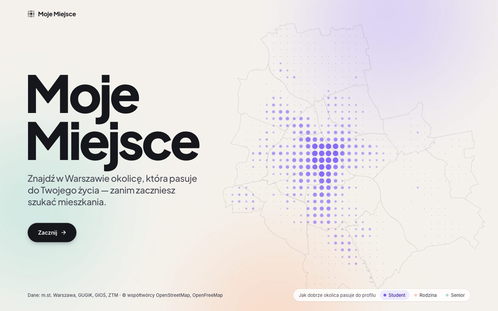
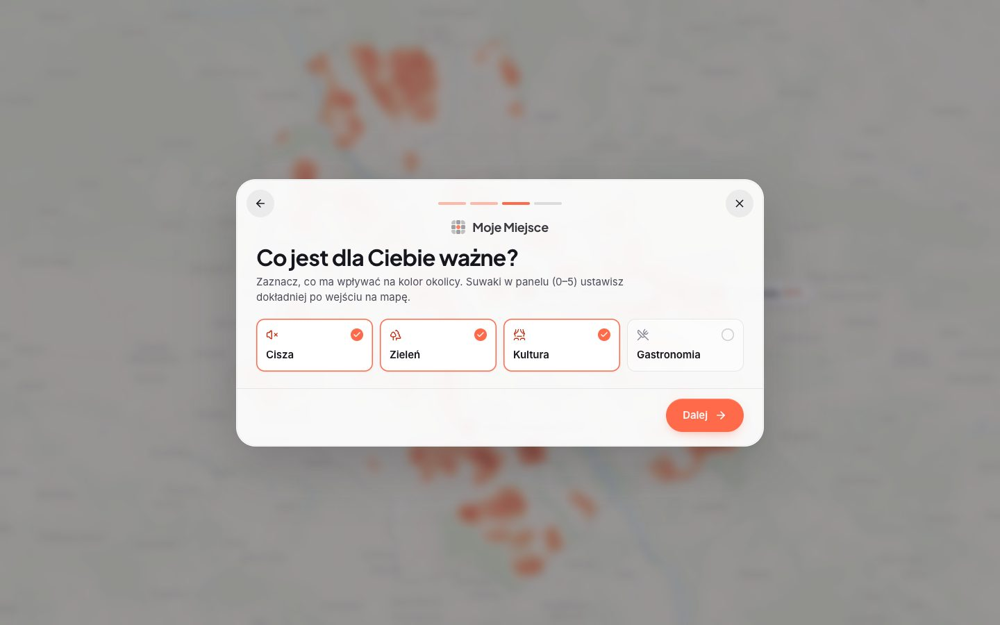
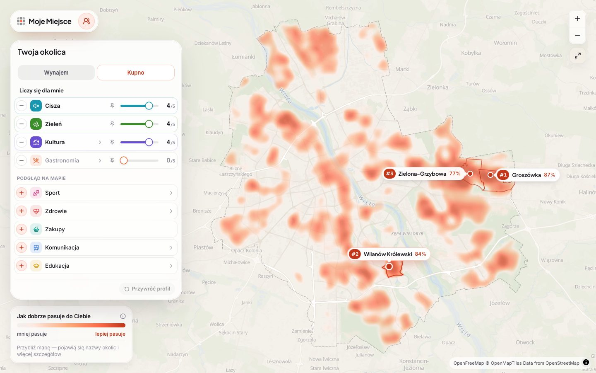
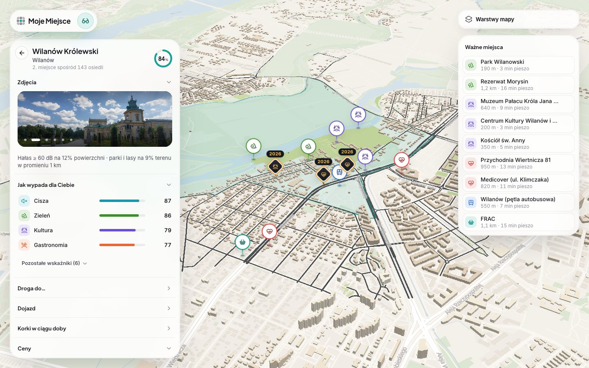
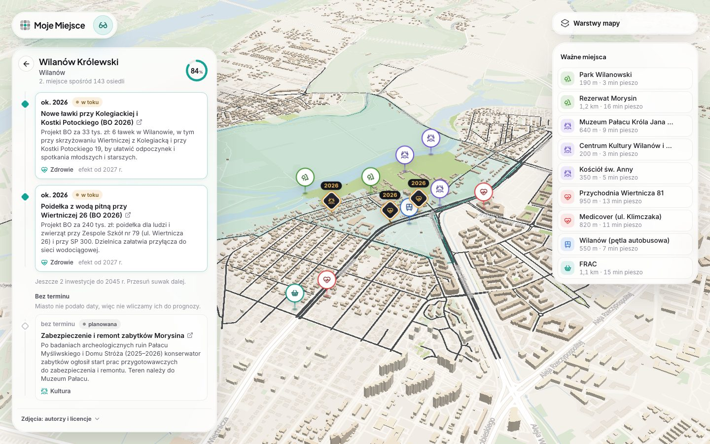
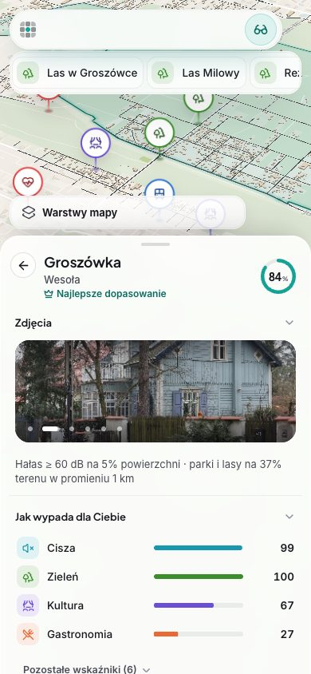

<h1 align="center">Moje Miejsce</h1>

<p align="center">
  <b>Znajdź w Warszawie okolicę, która pasuje do Twojego życia - zanim zaczniesz szukać mieszkania.</b><br>
  Mapa 143 osiedli dopasowana do Twojego profilu, na otwartych danych m.st. Warszawy.
</p>

<p align="center">
  
</p>

> Projekt zespołu nr **19 AI ALL IN** na **Warsaw Open Data Hackathon 2026** (kampus 42 Warsaw, 17–18.10.2026), wyzwanie W3 „Warszawa: Twój ruch!”.
> *English:* Moje Miejsce ("My Place") ranks Warsaw's 143 neighbourhoods for a personal profile (student, family, senior) using only open data, and lets you explore each one in 3D.

| | |
|---|---|
| Prezentacja (z filmem) | HTML: [`3_AI-ALL IN_Moje Miejsce/3_AI-ALL IN_Moje Miejsce.html`](3_AI-ALL%20IN_Moje%20Miejsce/3_AI-ALL%20IN_Moje%20Miejsce.html) (otwórz w przeglądarce, strzałki zmieniają slajdy) · PDF (zapasowy): [`3_AI-ALL IN_Moje Miejsce/3_AI-ALL IN_Moje Miejsce (plik zapasowy).pdf`](3_AI-ALL%20IN_Moje%20Miejsce/3_AI-ALL%20IN_Moje%20Miejsce%20%28plik%20zapasowy%29.pdf) |
| Film prezentujący system (2:25) | [`3_AI-ALL IN_Moje Miejsce/pitch/deck/media/moje-miejsce-system.mp4`](3_AI-ALL%20IN_Moje%20Miejsce/pitch/deck/media/moje-miejsce-system.mp4) |
| Skrypt wystąpienia | [`3_AI-ALL IN_Moje Miejsce/pitch/skrypt-wystapienia.md`](3_AI-ALL%20IN_Moje%20Miejsce/pitch/skrypt-wystapienia.md) |

## Problem

Ogłoszenia mieszkaniowe mówią o metrażu i cenie, a nie o tym, **jak się żyje w okolicy**: czy jest cicho, zielono, czy blisko do lekarza, szkoły, kultury i komunikacji. Ta wiedza jest rozsiana po wielu miejskich zbiorach danych. Moje Miejsce zbiera ją w jednym obrazie i pokazuje, **które osiedla pasują do Ciebie**, a nie do „średniego mieszkańca”.

## Jak to działa

1. **Wybierasz profil** (Student, Rodzina, Senior) i to, co jest dla Ciebie ważne: cisza, zieleń, kultura, gastronomia, sport, zdrowie, komunikacja, edukacja, zakupy, życie nocne. Wagę każdej kategorii ustawiasz suwakiem 0–5.
2. **Mapa pokazuje dopasowanie**: heatmapa liczona na siatce 250 × 250 m oraz ranking osiedli w procentach, osobno dla wynajmu i kupna.
3. **Wchodzisz w osiedle**: kamera przelatuje w widok 3D, a panel pokazuje wskaźniki, ważne miejsca z czasem dojścia, drogi do przychodni, parku czy kultury (także z własnego punktu startowego), dojazd, korki w ciągu doby, ceny i **oś czasu inwestycji do 2045 roku** z linkami do źródeł.

<table>
  <tr>
    <td width="50%"><br><sub><b>Profil</b>: student, rodzina albo senior ustawia punkt wyjścia.</sub></td>
    <td width="50%"><br><sub><b>Mapa</b>: heatmapa dopasowania, ranking osiedli i suwaki ważności.</sub></td>
  </tr>
  <tr>
    <td><br><sub><b>Osiedle</b>: widok 3D, wskaźniki, ważne miejsca i warstwy mapy.</sub></td>
    <td><br><sub><b>Oś czasu</b>: inwestycje do 2045 roku, każda z linkiem do źródła.</sub></td>
  </tr>
</table>

<p align="center"><br><sub>Działa także na telefonie.</sub></p>

## Na jakich danych

Wszystko pochodzi z otwartych źródeł, a **każdy plik, zbiór i metryka jest zapisany w [katalogu danych](data/catalog.json)** (10 źródeł, 41 zbiorów, 127 metryk; [podgląd](docs/data/katalog-danych.md)). Metryki są wyłącznie `REAL` (wprost ze zbioru) albo `DERIVED` (jawny wzór na zbiorach). Brak danych to `null` z podanym powodem, nigdy wartość zastępcza.

| Źródło | Do czego |
|--------|----------|
| Portal otwartych danych i usługi mapowe m.st. Warszawy | granice 143 osiedli, przystanki, toalety, boiska, AED, jakość powietrza, wydarzenia, utrudnienia drogowe, budżet obywatelski |
| Rejestr Cen Nieruchomości (RCN) | ceny transakcyjne mieszkań na osiedlach |
| GIOŚ | strategiczne mapy hałasu (drogi i kolej) |
| ZTM Warszawa (GTFS) | komunikacja, godzinowe spowolnienia na drogach z rozkładu |
| OpenStreetMap, OSRM | parki, szkoły, sklepy, budynki 3D, czasy dojścia i dojazdu |
| Wikimedia Commons | zdjęcia osiedli (autor i licencja przy każdym) |

Żadnych cen scrapowanych z portali ogłoszeniowych: walidator danych (`data/scripts/validate_data.py`) takie źródła odrzuca. Licencje i wymagane oznaczenia źródeł są w katalogu, a w aplikacji widać „Dane: m.st. Warszawa, GUGiK, GIOŚ, ZTM · © współtwórcy OpenStreetMap”.

## Technologia

React 19 · TypeScript · Vite · MapLibre GL (mapa, warstwy 3D) · Motion (animacje) · opcjonalnie Supabase. Dane przetwarzają skrypty Python w [`data/scripts/`](data/scripts/) (ETL, siatka 250 m w układzie EPSG:2180, metryki osiedli i kwartałów). Mapa bazowa to OpenFreeMap, więc aplikacja działa **bez żadnych kluczy API**.

## Uruchomienie

```bash
cd application
npm ci
npm run dev        # http://localhost:5173
```

Kontrola jakości (w `application/`): `npm test`, `npm run typecheck`, `npm run lint`, `npm run build`. Opcjonalne zmienne (Supabase, własny styl mapy): [`application/.env.example`](application/.env.example), szczegóły w [`docs/setup/README.md`](docs/setup/README.md). Dane i ich odtwarzanie: [`docs/data/START-here-data-dev.md`](docs/data/START-here-data-dev.md).

## Struktura repozytorium

| Folder | Zawartość |
|--------|-----------|
| [`application/`](application/) | aplikacja (React + Vite) |
| [`data/`](data/) | dane, skrypty ETL i katalog danych |
| [`docs/`](docs/) | koncept, dane i źródła, design, setup, notatki zespołu |
| [`3_AI-ALL IN_Moje Miejsce/`](3_AI-ALL%20IN_Moje%20Miejsce/) | prezentacja dla jury: slajdy, film produktowy, skrypt wystąpienia |
| [`pomysly-mati/`](pomysly-mati/) | ranking pomysłów z początku hackathonu |
| [`prototypes/`](prototypes/) | warianty interfejsu sprawdzane przed wyborem kierunku |
| [`scripts/`](scripts/) | skrypty pomocnicze repozytorium |

Na start: koncept [`docs/core/koncept-aplikacji.md`](docs/core/koncept-aplikacji.md), źródła danych [`docs/data/zrodla-danych.md`](docs/data/zrodla-danych.md), system wizualny [`docs/design/visual-system.md`](docs/design/visual-system.md).

## Jak pracujemy

`master` to gałąź integracyjna; zmiany idą przez osobne gałęzie `feat/…`, `fix/…`, `docs/…` i PR, a commity mają postać `feat: krótki tytuł`. Szczegóły: [`CLAUDE.md`](CLAUDE.md) i [`.cursor/rules/git-standards.mdc`](.cursor/rules/git-standards.mdc).
